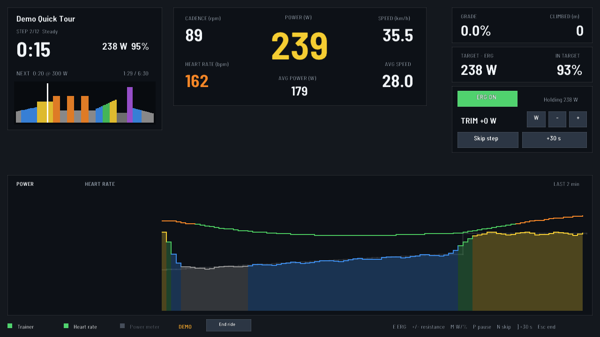
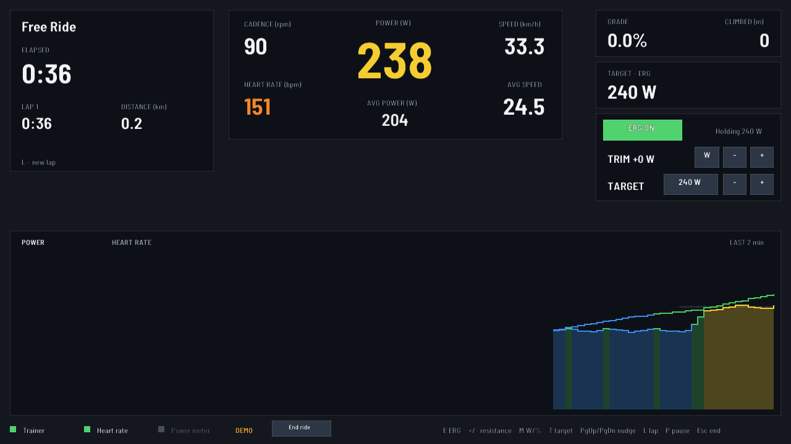
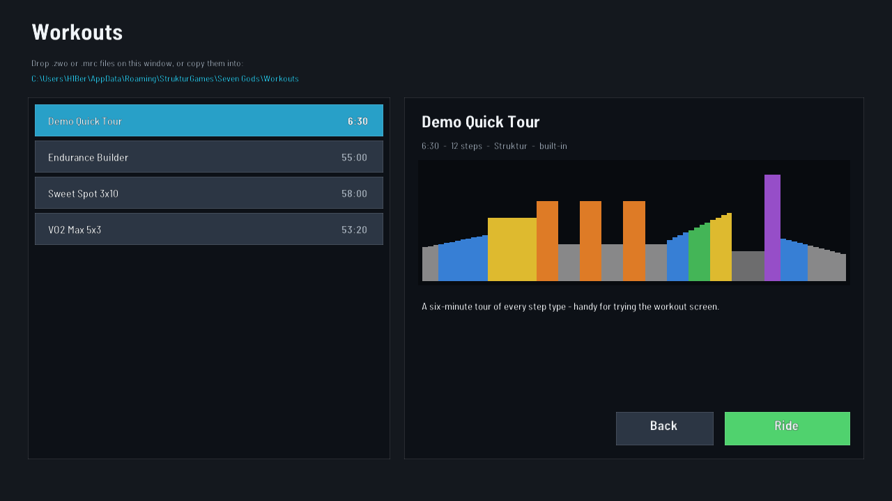

# Ride screens: Free Ride and Workout

Indoor-cycling screens built on the smart-trainer layer ([SmartTrainer.md](SmartTrainer.md)). They're opened from
the main menu (**Free Ride**, **Workouts**, **Ride Settings**) after device pairing and rider select
([RiderProfiles.md](RiderProfiles.md)).

| Workout | Free Ride | Workout browser |
|---|---|---|
|  |  |  |

*Screenshots from `--demo` with a synthetic rider, taken before the procedural world was added. Since then, a 3D
road is drawn behind the HUD; see [RideWorld.md](RideWorld.md).*

## Architecture

```
 Wren (assets/Scripts)                         C++ engine (src/Engine)                       C++ core (src/Engine/Ride)
 ─────────────────────                         ───────────────────────                       ─────────────────────────
 States/RideState ── "ride" module ──────────► RideIntegration/RideService ──owns──────────► RideSession
 UI/Ride/RideHudUI    (WrenBindings/            │  settings file, workout library,              ├─ WorkoutRunner (+ Workout, ZWO/MRC)
 UI/Ride/RideLayout    WrenRide.cpp)            │  output paths, command line               ├─ TrainerController (ERG/SIM)
 States/WorkoutBrowser                          │                                            ├─ SpeedModel
 States/RideSettings      ◄── ride* events ─────┤  ECS/System/RideSystem: Update each frame  ├─ RideLog → FitWriter / JSON
                           (rideTick ~4 Hz,     │  reads FitnessManager → SensorReadings     └─ Zones
                            rideCue, ...)       └─► Fitness::Trainer (FTMS control-point queue)
 UIGraph (engine UI element) ◄─ Ride.updateGraph / updateProfile fill it in C++
```

- **`StrukturRide`** (`src/Engine/Ride`) is a static library free of SDL, bgfx and Wren, built in the same standalone
  CMake project as `StrukturFitness`, so all of it is unit-tested:
  - **`Zones`:** Coggan 7 power zones from FTP. Heart-rate zones come from % of max HR (5 zones) or % of threshold
    HR (Friel, 7 zones). One shared colour palette.
  - **`SpeedModel`:** rider + bike mass, rolling resistance (Crr), drag area (CdA), air density, drivetrain
    efficiency and grade. Integrated through kinetic energy (`d(½mv²)/dt = P·η − F·v`, with a force form below
    1 m/s), giving distance, virtual elevation gain and altitude. `EquivalentGrade` inverts it for the ERG→SIM
    handover.
  - **`Workout` + `WorkoutLoader`:** steps carry a duration and an FTP-fraction target (steady, ramp, free ride, max
    effort), plus text cues. There's a ZWO loader (pugixml) and an MRC loader. Files are untrusted, so the loaders
    cap file size, step count, repeats, durations and power, and validate every number. A bad file fails with a
    clear message.
  - **`WorkoutRunner`:** runs on a monotonic clock, with pause, skip step, extend step and text-cue events. A 4 s
    lead-in ramp blends the target from the previous step's end into the new step.
  - **`TrainerController`** decides what the trainer is told, and when (see "Trainer control" below).
  - **`RideSession`:**
    - The timer starts on the first pedal stroke and auto-pauses after N seconds without power.
    - It records 1 Hz samples, with a lap per workout step or a manual lap in Free Ride, and tracks time in target.
    - It autosaves FIT + JSON.
  - **`RideLog` / `FitWriter`:** the FIT encoder is our own, written from the public FIT protocol. Files are written
    atomically (temp file + rename), so a crash mid-autosave never leaves a torn file.
  - **`RideSettings`:** app-wide options, persisted as `<save folder>/ride_settings.json`. Rider-specific values
    (FTP, max HR, threshold HR, weight, units) stay on the rider profile.
- **Engine:**
  - **`RideService`** owns the session and builds `SensorReadings` from `FitnessManager`:
    - The power source is chosen per the settings (Auto prefers a connected power meter).
    - Readings older than 3 s (power) or 5 s (heart rate) count as missing.
    - Session events are forwarded as `ride*` engine events, and `rideTick` fires about 4× a second while riding.
  - **`RideSystem`** ticks it every frame after `FitnessSystem`.
- **Wren screens** follow the events-not-polling rule: the HUD refreshes on `rideTick` and shows cues on `rideCue`.
  Clicks are queued and handled in `update()`, because they arrive inside the UI input pass.

### Layout (data-driven)

`assets/Settings/RideLayout.json` places every panel by `anchor` (both where it attaches on screen and its own pivot),
`position` and `size`, in the 1280×720 layout space. Move or resize panels there, with no code changes. A missing or
malformed entry falls back to its built-in default (`UI/Ride/RideLayout.wren`), so a bad edit can't break the screen.

| Panel id | What it shows |
|---|---|
| `workout` | Workout: name, step n/N + label, countdown, step target (W and % FTP), cadence target, next step, elapsed / total, mini profile with position marker. Free Ride: "Free Ride", elapsed, lap + lap time, distance. |
| `stats` | Power (3 s, zone colour), cadence, heart rate (zone colour, or dashes when the strap is gone), simulated speed, average speed, average power |
| `grade` | Grade (the simulated road) and virtual elevation climbed |
| `target` | The target being held: ERG target (step + trim), or the step target when ERG is off. Workouts also show % time in target. |
| `erg` | ERG badge (click or E). Resistance with −/+: ERG on means trim (W or %, toggle with the W/% button or M); ERG off means grade. Free Ride + ERG adds the target (click or T to type) with −/+ nudges. Workouts add Skip step and +30 s. |
| `cue` | Workout text cues |
| `banner` | "Start pedalling to begin", "Paused - pedal to resume" (auto), "Paused - press P to resume", "Workout complete!" |
| `graph` | Power (zone-coloured line + fill) and heart rate (zone-coloured line, own scale) over the last N minutes, the target as a step line behind the actuals, and a faint FTP line |
| `status` | Trainer / heart rate / power meter connection dots (green connected, red lost, grey none), DEMO tag, End ride |
| `hints` | Keyboard keys |

### Resolution scaling (1080p to 4K)

The UI is laid out in 1280×720 "game pixels" and stretched to the window. Two engine changes make that work at high
resolution:
- **Crisp fonts:** smooth fonts are baked at the window's real pixel density (`FontResource::LoadFromDisk`, capped at
  256 px per glyph). The ride screens' Barlow numbers stay sharp at 1080p and 4K. Pixel-art fonts are unchanged.
- **Mouse position:** the pointer is converted from window pixels to game pixels before hit-testing
  (`UIManager::HandleInput`), so clicks land when the window isn't 1280×720.

Fonts are baked when a screen loads them. After switching to fullscreen, the ride screens pick up the new density the
next time they open.

## Controls

| Action | Keyboard | Pad | Mouse |
|---|---|---|---|
| ERG on / off | **E** | Y | ERG badge |
| Resistance + / − (ERG on: trim; ERG off: grade) | **+ / −** (also keypad, **↑ / ↓**) | D-pad ↑ / ↓ | − / + buttons |
| Trim in watts ↔ percent | **M** | – | W/% button |
| Pause / resume | **P** | Start | – |
| Skip step (workout) | **N** | X | Skip step |
| Extend step +30 s (workout) | **]** | – | +30 s |
| New lap (Free Ride) | **L** | X | – |
| Type the Free Ride target (ERG on) | **T**, digits, Enter / Esc | – | target button |
| Nudge the Free Ride target ±5 W | **PgUp / PgDn** | bumpers | − / + buttons |
| End ride (asks first; saves) | **Esc** | B / Back | End ride |

The ride keys are raw keys, so they never clash with menu navigation. The HUD's buttons block arrow-key focus moves,
so ↑ / ↓ always mean resistance.

## Trainer control

- **ERG toggles at any time on both screens.** A workout starts in ERG; Free Ride starts in simulation on a flat road.
- **ERG on:**
  - **Free Ride:** the target is what you typed or nudged.
  - **Workout:** the target is the current step × FTP, with the lead-in ramp, plus your trim.
  - The target is clamped to the trainer's Supported Power Range, or the defaults (0–1500 W).
- **ERG off:** the trainer gets the simulated grade, clamped to the trainer's Supported Inclination Range (newly read
  from FTMS `0x2AD5`) or the defaults (−10 to +20 %). In a workout, no targets are sent, but the target and time in
  target are still shown and scored.
- **No step jumps when switching:**
  - **SIM→ERG** starts from the rider's current 3 s power.
  - **ERG→SIM** starts from the grade at which the rider's current power holds the current speed.
  - Both then ramp to the real value over 2.5 s.
- **Rate limit:** at most one command per second, only when the value changes. Commands go through
  `Trainer::SetTargetPower` / `SetSimulation`, which use the existing FTMS control-point queue (one outstanding
  procedure, coalesced targets).
- **ERG death spiral:**
  - **Easing down:** if cadence stays below 50 rpm for 3 s in ERG, the target eases down towards 50 % of itself over
    5 s. The ERG panel shows "Low cadence - easing off".
  - **Recovery:** once cadence is back above 65 rpm for 2 s, the target ramps back up over 5 s.
  - **Settings:** all of these thresholds are in `ride_settings.json` (`control.*`).
- **Simulation parameters:** FTMS Crr and Cw come from the speed model (Cw = ½ρ·CdA), so the trainer and the on-screen
  speed agree.

## Workouts

- **Formats:**
  - **ZWO:** Warmup, Cooldown, SteadyState, Ramp, IntervalsT (Repeat / OnDuration / OffDuration / OnPower / OffPower /
    Cadence / CadenceResting), FreeRide, MaxEffort, PowerLow / PowerHigh, and `textevent` cues (block-level IntervalsT
    cues are handed to the right on/off step). Unknown elements are skipped. A Cooldown always ramps down whichever
    attribute holds the higher value, because files disagree.
  - **MRC:** `[COURSE HEADER]` (`DESCRIPTION`, `FILE NAME`, a `MINUTES PERCENT` column line) and `[COURSE DATA]`.
    Equal consecutive levels make steady steps, different levels make ramps, and zero-length segments are jumps.
    `MINUTES WATTS` courses are refused with a message.
- **Safety limits (`WorkoutLimits`):**
  - Size: 1 MB per file, checked before reading.
  - Steps: 1000 after expanding repeats, at most 200 repeats.
  - Time: 6 h per step and 12 h in total.
  - Power: 400 % FTP.
  - Text: 512 characters per string.
  - XML: pugixml with `parse_default` never processes the DOCTYPE or fetches external entities. The test suite
    includes a billion-laughs / external-entity file.
- **Loading:**
  - **The Workouts browser** lists the built-in files (`assets/Workouts`) plus your own (`<save folder>/Workouts`,
    shown on screen), with a preview: length, steps, author, profile, description, or the reason a file won't load.
  - **Drag-and-drop** a `.zwo` / `.mrc` onto the window while the browser is open.
  - **Command line:** `Struktur.exe "C:\path\My Workout.zwo"` opens the browser with that file selected after rider
    select.
- **Built-in samples** (written for this project): Sweet Spot 3x10, VO2 Max 5x3, Endurance Builder (MRC), and Demo
  Quick Tour (6½ minutes, every step type).

## Saving rides

- **Where:** a finished ride is written to `<save folder>/Rides/<date>_<time>_<name>.fit` with a `.json` sidecar. The
  same files are autosaved every 60 s, so a crash loses at most about a minute.
- **When:** ending a ride by any route saves it, including leaving the state or quitting the game.
- **FIT contents:**
  - `file_id` (activity, manufacturer "development").
  - Timer `event`s around every pause.
  - One `record` per second of moving time: timestamp, power, heart rate, cadence, speed, distance, altitude. Missing
    values use FIT's invalid markers.
  - A `lap` per workout step (Free Ride: per manual lap).
  - `session` (cycling / indoor_cycling, with totals and averages).
  - `activity`.
- **JSON sidecar:** the raw 1 Hz log, including target, grade and ERG state, plus laps and the summary.

**Validation:**
- **Round trip:** `RideControlTests.cpp` decodes the file with an independent minimal decoder written in the test.
  It checks both CRCs, the message counts, and every record's fields against the log.
- **Independent decoder:** `python tools/validate_fit.py file.fit` (needs `pip install fitdecode==0.10.0`) checks the
  file structure the way an upload site would. Both FIT files written by the game during the demo run passed.
- **Not yet done:** uploading a file to Intervals.icu, Strava or Garmin Connect.

## Settings

Main menu → **Ride Settings**. Every change saves immediately.

| Row | Stored in |
|---|---|
| Rider (change), FTP, max HR, threshold HR, weight, units | the rider profile (`riders.json`) |
| Heart rate zones (% max HR / % threshold HR), graph window (2/5/10/20/30 min), power source (Auto / Trainer / Power meter), auto-pause (off/3/5/10/20/30 s), ERG trim in watts/percent | `ride_settings.json` |
| Pair devices | opens device pairing, then returns here |

Speed-model parameters (bike mass, Crr, CdA, air density, drivetrain efficiency), the target band, the lead-in and
the trainer-control thresholds are in `ride_settings.json`. They're validated and clamped on load.

## Demo mode and testing

```powershell
./build-nogame/Debug/Struktur.exe --demo
```

- **Demo devices:** `--demo` uses `SimulatedBleCentral`. The simulated trainer and heart-rate strap are remembered in
  memory only, so they connect at once and your real device choices on disk are untouched.
- **Synthetic rider:**
  - In ERG, power follows the trainer's target with about a 1 s lag and a little noise.
  - In simulation, power rises and falls with grade around 185 W, and cadence sags on climbs.
  - Heart rate drifts towards a level set by power over about 25 s.
- **Tests:** the standalone build (`cmake -S src/Engine/Fitness -B build-fitness`) runs 82 test cases, including:
  - ZWO / MRC parsing with sample, malformed and hostile files.
  - Zones, runner timing and the speed model.
  - The controller's ramps, rate limit, trims, clamping and cadence protection.
  - Session auto-pause, laps and time in target.
  - Settings, and the FIT round trip.
- **Screenshots** were captured from a scripted `--demo` run (a temporary Wren driver, not committed) that walked
  pairing → rider → menu → settings → browser → Free Ride (SIM, then ERG) → Workout (ERG, then ERG off) → end.

### Sensor loss

- **Heart rate:** a missing or stale strap shows dashes; heart rate falls back to the trainer's own value if it
  reports one.
- **Connection dots:** red means an assigned device was lost.
- **No power:** after the auto-pause delay the ride pauses, banner "Paused - pedal to resume", and resumes on the
  next pedal stroke.
- **Ending:** always asks first (Save & finish / Keep riding).

## Library choices

| Library | Use | Licence | How |
|---|---|---|---|
| pugixml 1.14 | ZWO parsing | MIT | FetchContent, release tarball pinned by SHA-256 (`2f10e276…a015`); `pugixml.cpp` compiled into `StrukturRide` |
| Barlow Semi Condensed (Medium / SemiBold / Bold) | ride screen font | SIL Open Font License 1.1 (embedding in a commercial game is allowed; the font can't be sold on its own) | vendored in `assets/Fonts/BarlowSemiCondensed` with `OFL.txt`, from google/fonts at commit `6ebe737e44fd64ee736bbc6feed6136a6dbfd222` |
| fitdecode 0.10.0 | test script only, never shipped | MIT | `pip install` |
| Garmin FIT SDK | not used | FIT Protocol License: the terms on redistributing the SDK were unclear, so the game has its own ~300-line encoder written from the published protocol | – |
| doctest, nlohmann/json | tests, JSON | MIT | already in the project |

No assets, logos, fonts or trademarks from Zwift or MyWhoosh are used. The layout only follows the common indoor-cycling
convention: workout top left, stats top centre, controls top right, graph along the bottom.

## Decisions

- **Entry and flow:** ride screens are reached from the main menu, alongside the game. The rider must already be
  selected (at startup).
- **Look:** a clean modern style for the ride screens (dark panels, Barlow). The pixel-art kit stays for the menus.
- **Settings:** rider numbers live on the profile, and app-wide options in `ride_settings.json`. HR zones default to %
  of max HR, so max HR was added to the rider profile.
- **Where the logic runs:** in C++ (`RideSession`), so timing never depends on scripts and everything is
  unit-testable. Wren is only the view and input layer.
- **Lead-in:** the ramp is applied at the start of the new step (4 s), so step lengths stay exact.
- **Workouts start in ERG.** Free Ride starts in simulation at 0 %, with the ERG target defaulting to 65 % of FTP.
- **Auto-pause:** the ride waits for the first pedal stroke, and auto-pause resumes on its own. A manual pause only
  resumes with P.

## Open questions

1. **Pad mapping:** the X button skips a step in workouts and starts a lap in Free Ride. Change it if you prefer
   different controls.
2. **Typed target on a pad:** the Free Ride target is typed on a keyboard. Pads use the −/+ nudges (5 W). Should the
   on-screen keyboard from the rider editor also be offered here?
3. **Recovery when ERG is refused:** if the trainer refuses ERG, the controller keeps trying. Should it switch the
   badge to SIM automatically after a `COMMAND_UNSUPPORTED` event?
4. **Sample timing:** records are written per second of moving time, so pauses show as gaps between timestamps
   (standard, with timer events). Some sites prefer zero-speed records instead.
5. **Fullscreen font re-bake:** fonts re-bake only when a screen loads them after a resolution change. Should toggling
   fullscreen re-bake live?

## Not hardware-verified (please test)

Everything here ran against the simulator and unit tests only.

1. **ERG on real trainers:** Set Target Power accepted and held on the Elite Direto and KICKR v4, including the 2.5 s
   handover ramps and the one-command-per-second rate limit (a real control-point round trip may take longer than
   1 s; the queue coalesces, but check that it feels smooth).
2. **Simulation grade:** how the Direto and KICKR respond to the grade sent in SIM, whether either reports a Supported
   Inclination Range (`0x2AD5`), and whether the Cw/Crr values feel right.
3. **ERG↔SIM switching on real trainers:** whether the equivalent-grade handover actually avoids a lurch.
4. **Cadence protection:** the ease-down and recovery with a real rider.
5. **Power source:** "Auto" choosing a real power meter over the trainer, and staleness timeouts with real
   notification rates.
6. **Auto-pause and resume:** with real sensors, including a trainer that keeps reporting a few watts while coasting.
7. **FIT upload:** importing a saved ride into Intervals.icu, Strava and Garmin Connect, including the lap split,
   pauses and the indoor_cycling sub-sport.
8. **4K and fullscreen:** text sharpness and mouse hit-testing at 1080p and 4K. Only 1280×720 windowed was captured;
   the font-density and pointer-scaling code paths at higher resolutions haven't been seen on screen.
9. **Drag-and-drop:** dropping files from Explorer onto the window (the event path is wired, but no real drop was
   performed in the test run), and command-line paths with non-ASCII characters.
10. **Physical-keyboard target typing and keyboard controls:** the scripted run drove the ride through the `ride`
    module, not real key presses.
11. **Long rides:** an autosave during a multi-hour ride, and crash recovery from an autosaved file.
