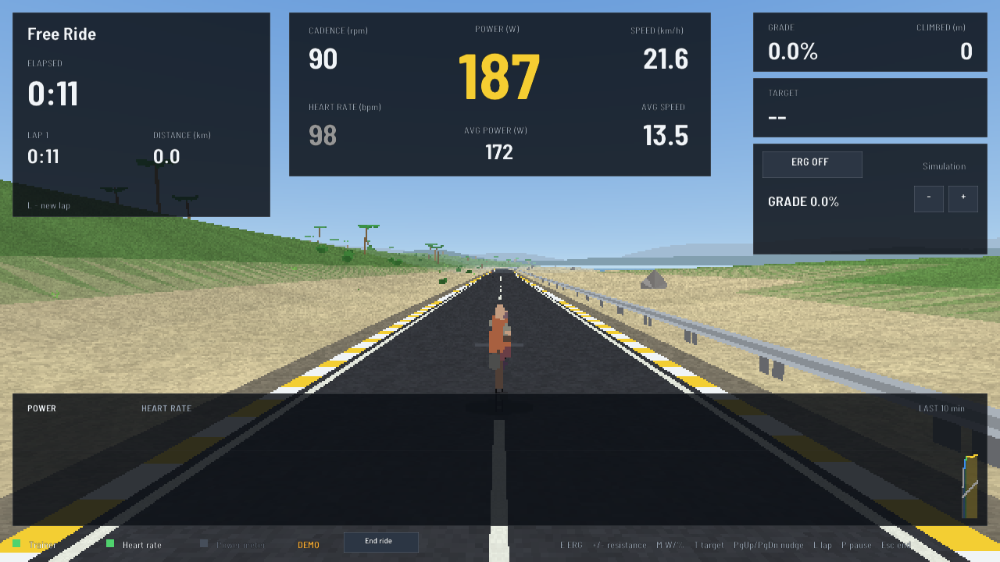
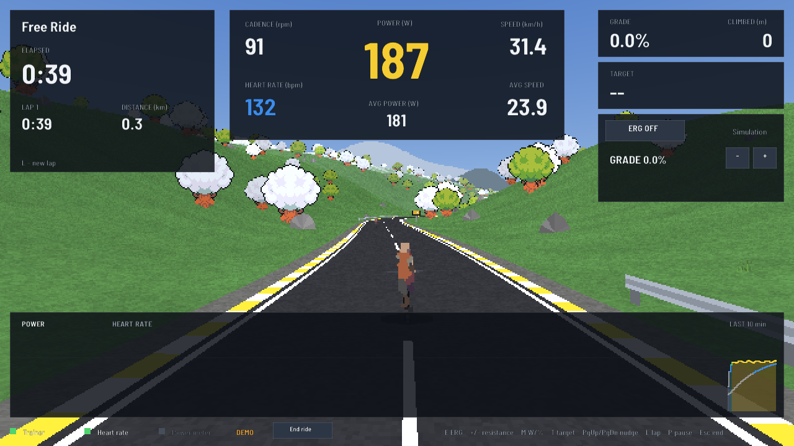
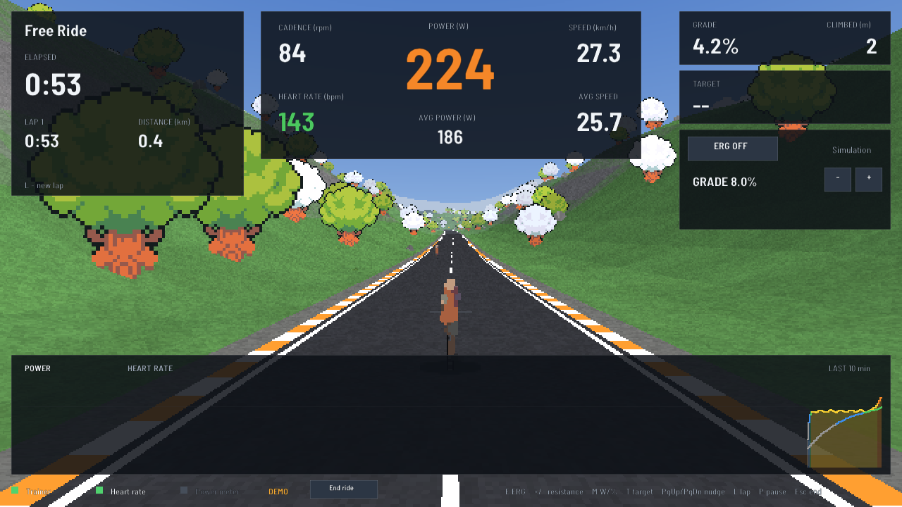
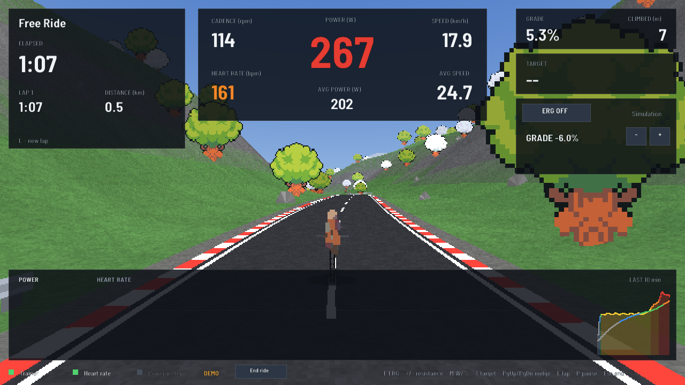
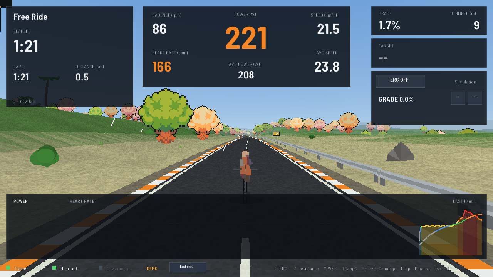
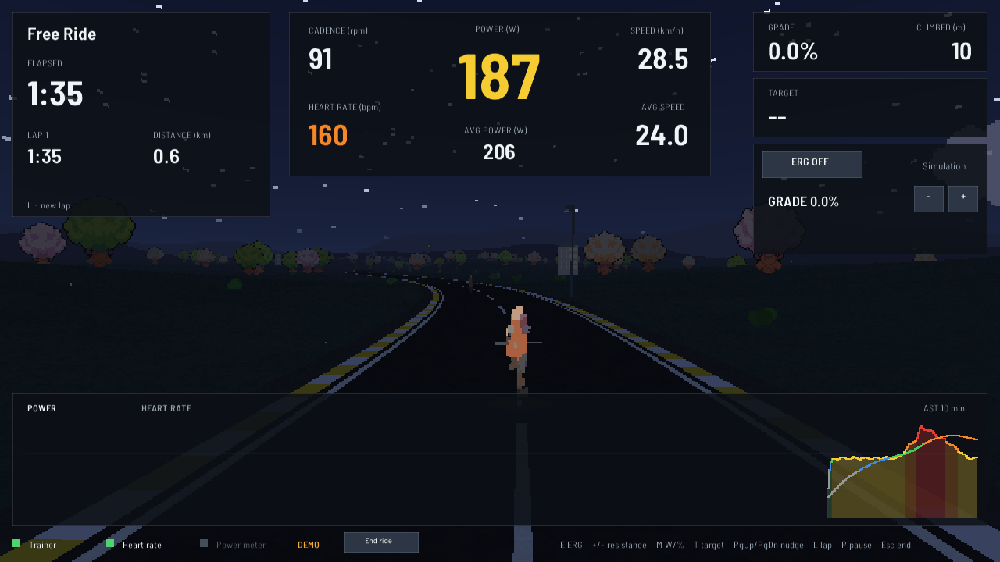
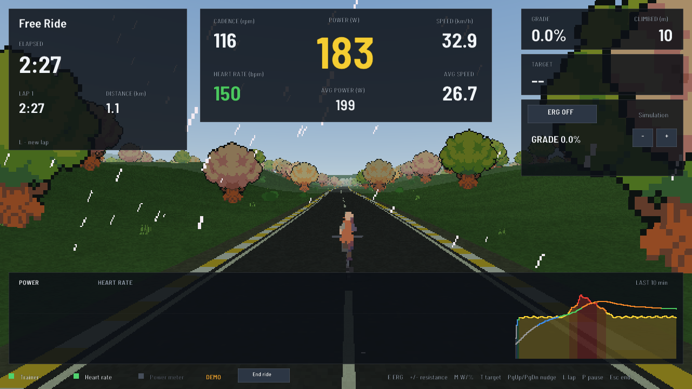
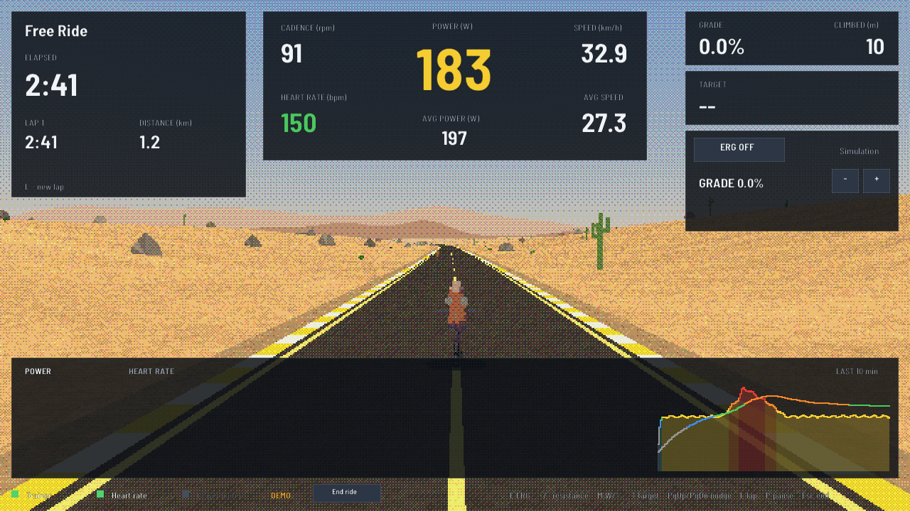
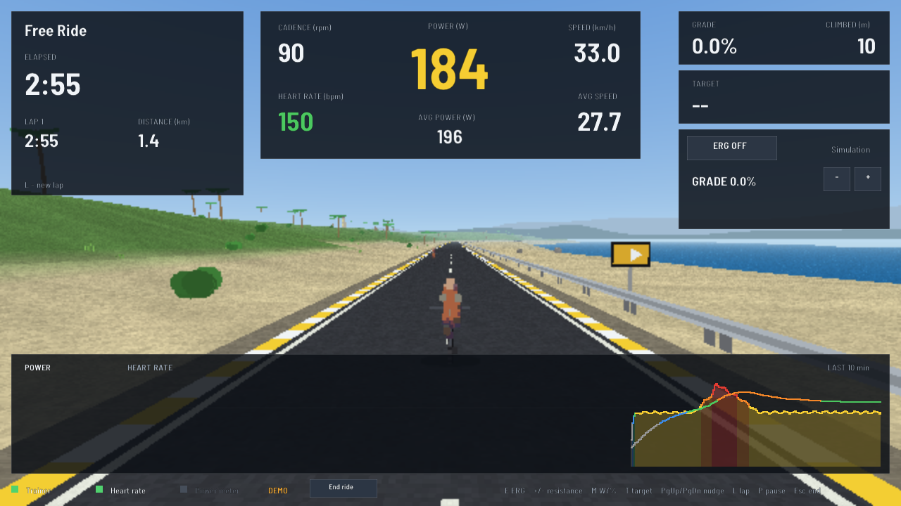

# The world: the procedural road behind the ride screens

An endless, seeded 3D road drawn with bgfx behind the Free Ride and Workout HUDs ([RideScreens.md](RideScreens.md)),
with a rider sprite whose legs follow your cadence. All art is replaceable data; anything missing is drawn by a
code placeholder, so the game always runs ([missing-assets.md](missing-assets.md)).

| Flat, coastal (sea on the right) | Tight bend, alpine | Climb (8 % set, road blending up) |
|---|---|---|
|  |  |  |
| **Descent** (−6 %, rumble strips in zone 5 red) | **Biome transition** coastal → forest | **Night** (lamps, buildings, stars) |
|  |  |  |
| **Rain, 116 rpm spin-up** | **Pixel + dither + CRT lines** | **Smooth** (linear upscale, smooth shading) |
|  |  |  |

*All from `--demo` at 1280×720 on the code-drawn placeholders. The F3 overlay is in
[world-debug.png](Images/world-debug.png).*

## Architecture

```
 Wren                       game (C++)                                      src/World (pure C++, unit-tested)
 ────                       ──────────────────                              ────────────────────────────────────────
 RideState                  "world" module ─► LoadWorld / UnloadWorld ──►   World::World  (on the GameContext)
   World.load(settings)        ├─ World::Load                                ├─ Route          centripetal Catmull-Rom
   World.unload()              ├─ Renderer::WorldRenderer::Initialise        ├─ ElevationProfile  h(s), grade limits
                               └─ entities: rider, camera, pacer             ├─ BiomeSequence  JSON biomes, blended
 Input.trainer  ◄───────── RideSystem writes it (devices + ride)             └─ ChunkStreamer  job tasks, mesh pool
                            update: Ride ─ World ─ Pacer ─ RiderAnimation ─ Camera
                            render: WorldRenderSystem ─► WorldRenderer      RoadFollow, Pacer, RiderAnimation
```

- **`RideWorld`** (`src/World`) has no SDL, bgfx or Wren. It builds in the standalone test project
  (`cmake -S tests -B build-tests`), so the world, camera following, pacer motion and rider animation
  are covered by `RideWorldTests.cpp`. It knows nothing about trainers or rides: `World::Update(delta,
  Input::TrainerInput)` takes speed, chosen grade, ERG, power zone and the workout's intensity ahead, so `--demo` and
  the tests drive it exactly like a real ride.
- **Loading is explicit.** The `World` and `WorldRenderer` live on the `RideContext`, empty until a script calls
  `World.load(Ride.worldSettings())`; `RideState` loads it on entry and unloads it on exit.
- **The ride and the world are separate.** `RideService` owns the settings, workouts and session and never touches
  the world. `RideSystem` links them: it hands the world's road grade to the session
  (`TrainerController::SetRoadGrade`, so SIM simulates the road under the rider) and places a finish banner 90 m ahead
  when a workout finishes.
- **Entities** (`src/Components/WorldComponents.h`, all tagged `WorldMember` and destroyed on unload):

  | Entity | Components | Moved by |
  |---|---|---|
  | The player's rider | `RoadPosition`, `CrankAnimation`, `RiderSprite` | `WorldSystem`, `RiderAnimationSystem` |
  | Pacer (`--demo`) | `RoadPosition`, `CrankAnimation`, `Tint`, `Pacer` | `PacerSystem`, `RiderAnimationSystem` |
  | Finish banner | `RoadPosition`, `Banner` | removed by `WorldSystem` once passed |
  | Camera | `Camera3D`, `World::RoadFollow` | `CameraSystem` |

  `PacerSystem` and `RiderAnimationSystem` are worker systems (the engine's docs/JobSystem.md). Chunks aren't entities: they're
  built on workers and recycled constantly, so they stay inside the streamer.
- **Camera:** `World::Camera` is a 3D camera (position, target, field of view, near/far, view and projection
  matrices) on the context. `CameraSystem` follows the rider along the road and writes it; `WorldRenderer` draws
  through it.
- **Textures** go through the `ResourceManager`. Role art is decoded in parallel (`PrefetchTextures`); frames cut
  from sheets and code-drawn placeholders are registered as `world/...` textures.
- **`WorldRenderer`** (`src/Renderer`) turns the world and its entities into bgfx draws.

### Route and elevation

- **Route**
  - Control points every 140 m.
  - Each heading is seeded noise: a long sweep, shorter wiggles and occasional tight bends. Every heading stays
    within 75° (with a margin) of the route's mean direction, so the road never doubles back on itself.
  - The turn at each control point is limited to `spacing / (3.8 × minCurveRadius)`.
  - A centripetal Catmull-Rom spline runs through the control points, sampled densely and resampled every 1 m of arc
    length. Curvature comes from the heading change across ±2 samples.
  - The tests check over 100 km and three seeds that curvature ≤ 1/`minCurveRadius` (peak ≈ 0.8 of the limit, so
    tight bends do appear), spacing is exact and heading stays bounded.
- **Elevation h(s)** is separate from the horizontal route.
  - Behind the rider it's history and never changes.
  - Every frame, the profile ahead is re-derived from a target grade for each metre. The derivation starts from the
    grade under the rider, is limited to ±`maxGradePercent` and changes by at most `maxGradeChangePerMeter`. With
    unchanged targets it reproduces the same road, so nothing ahead wobbles.
  - Grade = dh/ds.
- **Grade source** (`world.gradeSource`):
  - **`manual` (default)**
    - **SIM:** the road ahead blends towards the grade you set with −/+, and the trainer gets the grade under the
      rider. One percent of grade change takes 20 m of road.
    - **ERG (workout):** the grade is cosmetic. It comes from the target intensity at the time you'll reach that
      point: recovery is flat or downhill and threshold or harder is a climb (`GradeForIntensity`: −3 % … +9 %).
    - **ERG (Free Ride):** a gentle procedural profile (±3 %).
  - **`route`:** the procedural profile, scaled by the biome's `grade.amplitude`/`wavelength`. In SIM the trainer
    simulates it.
- **Limits:** a grade you set above `maxGradePercent` is capped at it, and the HUD shows the grade actually sent.

### Terrain, road, water, props

- **Chunks**
  - 64 m along the road, built in road coordinates (s, t): vertex = P(s) + N(s)·t + height. Positive t is left.
  - Heights are relative to the road. The road's own h(s) is added in the vertex shader from a 2048 × 1 R32F height
    texture (1 m per texel), refreshed every frame. That's what lets the profile ahead change after a chunk was built.
- **Terrain**
  - Rows every 2 m. Columns get sparser with distance from the road edge, out to the quality's lateral extent
    (220/320/420 m).
  - A flat corridor sits beside the road, then blends into 4-octave value noise in world (x, z), with per-side
    offsets (e.g. the coast falling away to the sea).
  - **Inside of bends:** columns are clamped to 0.7 × the tightest radius within ±12 m, so the grid can't fold. The
    test builds 100 km of chunks and finds no inverted quad.
- **Colours**
  - Each vertex is coloured from the biome palette (first rule matching its height and slope) with a little
    per-vertex variation.
  - A material index (grass, rock, snow, sand, water) picks the detail texture in the shader.
  - Flat shading (default) emits per-triangle vertices with the face normal.
- **Road**
  - A two-edge ribbon over the shoulders.
  - `fs_rideRoad` draws everything else from (distance, lateral): asphalt texture, shoulder, solid edge lines, the
    dashed centre line (4 m on, 5 m off) and rumble strips in the rider's power-zone colour.
- **Water** strips on the biome's water side at `water.level`. A biome without water sinks its level out of sight, so
  transitions blend.
- **Props**
  - Per biome rules: `scatter` (density per 1000 m² in a lateral band) or `edge` (every `spacing` m at a fixed
    offset, optionally only on the outside of bends).
  - Seeded per chunk, so they're deterministic.
  - Drawn with instancing: one draw per prop type per chunk, culled by the type's `maxDistance`.
  - Camera-facing billboards, or road-aligned quads for guardrails, buildings and the banner.
- **Streaming**
  - The window covers 64 m behind to the quality's draw distance ahead (640/1000/1536 m).
  - Missing chunks are requested nearest-first (at most 4 per frame). Each is built as a background task on the
    engine's job system (the engine's docs/JobSystem.md), from copies of the route samples, so several build at once. A settings
    change takes back the meshes of builds that haven't started; running ones finish and are recycled. With zero
    workers (web) the builds run on the main thread within the frame budget.
  - Finished meshes become static vertex/index/instance buffers. Chunks behind are destroyed and their CPU meshes
    go back to a pool. The tests check that the pool and buffer capacity stay flat over 30 km, that job-system and
    inline builds give identical meshes (with 4 workers and with 0), and that settings changes and destroying the
    world mid-build are safe.

### Rendering and views

| View | Target | Content |
|---|---|---|
| `RideSkyViewId` (10) | low-res framebuffer, ortho, sequential | gradient, stars, two mountain bands, sun halo; then sun / moon / clouds sprites |
| `RideSceneViewId` (11) | same framebuffer, perspective, sequential | terrain, water, road, props, banners, actors, rain / snow |
| `RideOverlayViewId` (12) | same framebuffer, ortho | shadow + rider sprite layers |
| `RidePostViewId` (13) | the world target (backbuffer or editor viewport) | upscale (nearest or linear), optional dither + scanlines |

- **View order:** `bgfx::setViewOrder` (in `GraphicsDevice::Initialise`) runs these after `WorldViewId` and before
  Debug/UI, so the HUD stays at native resolution on top.
- **Precision:** chunks are translated relative to the camera (x/z in double on the CPU), and heights are relative to
  h(rider), so precision holds over any distance.
- **Shaders:** `shaders/{vs,fs}_ride{Terrain,Road,Prop,Sky,Post}.sc` with their own
  `varying_rideWorld.def.sc` and `rideCommon.sh`. The game's CMake compiles them with the engine's
  `struktur_add_shaders`. Every profile was compiled (D3D11 `s_5_0`, GLSL 120,
  ESSL 100/300, SPIR-V).
- **WebGL2 / no compute:**
  - No compute shaders.
  - Instancing, plus vertex texture fetch for the height texture. A GPU without R32F vertex textures gets a warning
    and a flat road.
- **Retro look**, all toggleable:
  - Nearest-neighbour upscale.
  - Flat vertex colours.
  - Banded fog (`fogBands`).
  - Palette quantisation with 4×4 ordered dithering.
  - CRT scanlines.
  - The settings screen offers presets: Pixel (default), Pixel + dither, Pixel + CRT lines, Smooth.
- **Camera**
  - Sits `cameraDistance` (default 7 m) behind the rider at `cameraHeight` (1.5–3 m, default 2.2), looking 22 m
    ahead along the spline.
  - Pitch comes from the height difference to the look-ahead point, smoothed (0.35 s).
  - Optional cadence bob, and FOV widening with speed (+0.8°/m·s above 5 m/s, max +10°).
  - **Comfort mode** turns off every camera motion effect.
- **Debug overlay** (F3 in a ride, or Ride Settings → Show world stats): frame time and fps, bgfx draw calls and
  triangles, chunk build time (last / average / max), ready / pending / pooled chunks, prop draws / instances, biome
  blend, distance, grade, scene size and quality.
  - In the demo run (Debug build, RTX 4070, Medium, 640×360): about 7.5 ms per frame, 158 draw calls, 42k triangles,
    51 prop draws / 253 instances, chunk builds of 1.4 ms average and 2.4 ms max.
- **Instancing in this bgfx:** instance data starts at `TEXCOORD31` (`BGFX_CONFIG_INSTANCE_DATA_FIRST_TEXCOORD`), not
  the older `TEXCOORD7`, so `varying_rideWorld.def.sc` declares `i_data0 : TEXCOORD31`. With the old semantics, props
  were drawn at the chunk origins at absurd sizes.
- **Weather:** about 600 particles (Medium) in a 32 m box that wraps around the camera. Particles within 2.5 m of the
  eye are skipped.

### Quality presets

| | Low | Medium | High |
|---|---|---|---|
| Draw distance | 640 m | 1000 m | 1536 m |
| Terrain either side | 220 m | 320 m | 420 m |
| Prop density | 0.4 | 0.7 | 1.0 |
| Low-res scene height | 270 | 360 (640 × 360 at 16:9) | 480 |
| Weather particles | 250 | 600 | 1200 |

Web builds default to Low (`WorldSettings::Defaults`).

## Rider sprite

- **Placement:** drawn from behind in the low-res scene, so its pixels match the world.
  - **Position and size:** projected from the rider's real place on the road (the camera is `cameraDistance` behind),
    `heightMeters` tall. It sits at the lower centre, on the road, at the right size, and stays clear of the graph
    panel.
  - **Shadow:** a soft shadow underneath.
  - **Lean:** into bends (`atan(v²κ/g)`, max 18°, smoothed).
- **Crank:**
  - **Phase:** `phase += smoothedCadence / 60 × dt`. Cadence is exponentially smoothed with τ = 0.35 s, so jittery
    sensor values don't show.
  - **Frame:** `floor(phase × framesPerRevolution) % framesPerRevolution`.
  - **Cadence 0:** the coasting frame, legs frozen.
  - **No cadence source:** the idle pose (one foot down).
  - **Above 125 % FTP:** the out-of-saddle row, sitting back down below 110 %.
- **Wheel:** angle += speed / 0.34 m × dt. The rear view scrolls a tileable tread strip. A side-on wheel (`rotate`)
  rotates the layer and fades it once spokes would strobe.
- **Strobing ("wagon-wheel")**
  - **Legs:** they can only appear to run backwards when they advance half a revolution per displayed frame
    (> 1800 rpm at 60 fps), which never happens. The frame count only decides smoothness: 8 frames per revolution
    is the minimum that still reads as pedalling (45° steps); 12 is recommended and is what the placeholder uses.
  - **Spoked side-on wheels:** they alias early. A 6-spoke wheel strobes above ≈ 5 rev/s (≈ 39 km/h); a 32-spoke wheel
    already at ≈ 1 rev/s. `WheelAliases()` decides when to fade to a blur.

### The shipped rider: the Explorer on the bike

`rider.json` draws the Explorer's run cycle over the bike: wheel, bike frame, then the Explorer.
- **Frames:** `upRunAnimation` (8 frames) is one crank revolution, so its legs step in time with your cadence. The
  first `upIdleAnimation` frame is the idle pose when there's no cadence sensor, and run frame 0 is the coasting
  pose.
- **Cut-out:** the frames come straight from `Actors/explorer.png` through the manifest's `regions` (`rider_explorer`
  role).
- **Placement:** the layer's `rect` (`[-16, 9, 97, 92]`) scales the 46×44 cells about 2.1× so the hips sit on the
  saddle and the feet reach the pedals. A rect may reach outside the 64×96 frame.
- **Repacking:** `build_sprites` can repack the atlas. If it does, update the regions; the cell grid is in
  `Scripts/Sprites/ExplorerSprite.wren`.
- **Going back to the drawn rider:** replace that layer with the `rider_legs` + `rider_torso` layers
  (`DefaultSpriteDescriptor`).

### Sprite descriptor (`assets/World/Rider/rider.json`)

```json
{
  "kind": "layered",            // or "sheet": one role with every pose
  "frameSize": [64, 96],        // pixels per frame
  "framesPerRevolution": 12,
  "anchor": [32, 94],           // the pixel on the road between the wheels
  "screenHeight": 0.32,         // fraction of the screen
  "heightMeters": 1.85,         // as a world actor (pacer / ghost)
  "lean": true,                 // rotate into bends
  "leanLeftRow": -1, "leanRightRow": -1,  // optional lean art (sheet): rows used instead of rotating
  "layers": [                   // drawn in order
    { "name": "wheels", "role": "rider_wheel", "motion": "scroll", "rect": [29, 58, 6, 38] },
    { "name": "frame",  "role": "rider_frame", "motion": "static" },
    { "name": "legs",   "role": "rider_legs",  "motion": "crank",
      "rows": { "pedal": 0, "outOfSaddle": 1, "still": 2 }, "coastColumn": 0, "idleColumn": 1 },
    { "name": "torso",  "role": "rider_torso", "motion": "static", "outOfSaddleOffsetY": -7 }
  ]
}
```

- **Motions:**
  - `static`: frame 0.
  - `crank`: column from the crank phase, row from the pose.
  - `scroll`: a tileable strip scrolled with the wheel angle (rear view).
  - `rotate`: rotates about the rect's centre (side view). Add `"spokes": n` for the strobe check.
- **Flat sheet:** use `"kind": "sheet"` with one `crank` layer whose role is `rider_sheet`.
- **Per-layer cycle:** a `crank` layer can set its own `"framesPerRevolution"` (the Explorer uses 8, while the
  descriptor's default is 12).
- **Bad descriptor:** an invalid file falls back to the built-in descriptor, with a warning in the log.

## Biome data (`assets/World/Biomes/*.json`)

Adding a biome is a data-only change: drop a new `.json` file in the folder. Every file is loaded (sorted by name),
and the seeded sequence picks between them by `weight`, never the same biome twice in a row. Each region is
`lengthMeters` long and blends into the next over 500 m. Unknown keys are ignored and values are clamped. Colours
are `[r, g, b]` (0–255) or `"#rrggbb"`.

```json
{
  "id": "coastal", "name": "Coastal", "weight": 1.0, "lengthMeters": [3500, 6000],
  "sky":   { "zenith": [70,130,210], "horizon": [190,220,240], "ground": [120,150,160], "stars": 0, "moon": 0, "clouds": 0.5 },
  "sun":   { "timeOfDay": 15.0, "azimuth": 210, "color": [255,244,220], "size": 1.0 },
  "ambient": [120,130,145],
  "fog":   { "color": [185,212,232], "density": 0.0016, "start": 80 },
  "mountains": { "far": [150,175,200], "near": [120,150,165], "height": 0.06 },
  "terrain": { "amplitude": 14, "scale": 260, "corridor": 2, "blend": 40, "leftOffset": 6, "rightOffset": -26,
               "palette": [ { "material": "sand", "maxHeight": 1.2, "color": [222,205,160] },
                            { "material": "rock", "minSlope": 0.9, "color": [140,132,120] },
                            { "material": "grass", "color": [112,160,82] } ] },
  "road":  { "asphalt": [64,66,72], "shoulder": [150,140,120], "line": [240,240,230] },
  "water": { "enabled": true, "level": -4.0, "side": "right", "color": [40,110,160] },
  "weather": { "type": "none", "intensity": 0 },        // none | rain | snow
  "grade": { "amplitude": 3.0, "wavelength": 1100 },     // route grade source / Free Ride ERG
  "props": [
    { "role": "tree_palm", "placement": "scatter", "side": "left", "density": 0.9, "lateral": [9, 90],
      "height": [6, 10], "maxDistance": 900 },
    { "role": "guardrail", "placement": "edge", "side": "outer", "spacing": 4, "lateral": [5.6, 5.6],
      "height": [0.8, 0.8], "minCurvature": 0.004, "alignToRoad": true }
  ]
}
```

- **`timeOfDay`** sets the sun height. A biome with `stars` ≥ 0.5 is night: moonlight, stars, no sun disc.
- **Palette rules** use the height relative to the road and the slope (0 = flat, 1 = 45°). The first match wins.
- **Prop `side`:** `both`, `left`, `right` or `outer` (the outside of the bend, for edge props).
- **Prop roles** are manifest roles, so any art can be added the same way.
- **Shipped biomes:** coastal (palms, sea on the right), alpine (55 m relief, snow above 38 m, guardrails on bends,
  steeper route grades), desert, forest (rain) and night (lamps, buildings, light snow).

## Asset manifest (`assets/World/manifest.json`)

One entry per art role: `role`, `category`, `file` (relative to `assets/`), `size` per frame, `frames`, `rows`,
`framesPerRevolution`, `anchor`, `tileable`, `format`, `notes`, and the `placeholder` (`shape` + `color`).

- **Missing file:** the renderer generates the placeholder in code (`World::GeneratePlaceholder`).
- **`regions`:** an optional list of `[x, y, w, h]` cut-outs from a larger sheet (a tileset, a character atlas). Each
  region becomes one frame, placed bottom-centre in equal cells (`ComposeRegions`, tested). The trees and the
  Explorer use this.
- **Replacing art:** drop a PNG at `file`, or point `file` at an existing asset. Nothing else changes.
- **Safety:** paths are checked (relative only, no `..`, no drive letters).
- **Mapped to existing assets:** seven roles point at the current pack:
  - `rider_shadow` → `Actors/Character/Shadow.png`.
  - `sky_clouds` → `FX/Particle/Clouds.png`.
  - `particle_rain` → `FX/Particle/Rain.png`.
  - `particle_snow` → `FX/Particle/Snow.png`.
  - `tree_broadleaf` (green, autumn, blossom) and `tree_pine` (snowy, green) → the bottom-row trees of
    `Backgrounds/Tilesets/TilesetNature.png`.
  - `rider_explorer` → the Explorer atlas.
- **Biome tweaks for the square tileset trees:** they're placed smaller (5–10 m), and the forest uses only the leafy
  ones (the snowy tree stays in the alpine).
- **Logging:** the missing list is logged once at startup.
- **`Struktur.exe --list-missing-assets`** prints it as the Markdown table in [missing-assets.md](missing-assets.md)
  and quits. The engine log goes to stdout as well, so the table is the lines starting with `|`.

## Settings (`ride_settings.json` → `"world"`)

| Key | Default | |
|---|---|---|
| `enabled` | true | draw the world (off: the HUD gets its solid backdrop back) |
| `seed` | 1 | same seed, same road, terrain, props and biome order |
| `quality` | `medium` (`low` on web) | `low` / `medium` / `high` (table above) |
| `lowResHeight` | 0 | scene height override (0 = the preset's) |
| `gradeSource` | `manual` | `manual` / `route` |
| `biome` | `auto` | a biome id to stay in one biome |
| `maxGradePercent` | 12 | road grade limit |
| `maxGradeChangePerMeter` | 0.05 | % per metre |
| `minCurveRadius` | 90 | metres |
| `roadHalfWidth`, `shoulder` | 3.5, 1.2 | metres |
| `cameraHeight`, `cameraLookAhead`, `fieldOfView` | 2.2, 22, 62 | metres, metres, degrees |
| `comfortMode` | false | no camera motion effects |
| `cadenceBob`, `speedFov` | false, true | camera effects |
| `nearestUpscale`, `flatShading`, `bandedFog`, `fogBands` | true, true, true, 8 | retro look |
| `dither`, `paletteLevels`, `scanlines` | false, 6, false | |
| `debugOverlay` | false | F3 |
| `demoPacer` | true | the pacer rider (`--demo` only) |

The Ride Settings screen's second column edits on/off, quality, grade source, scenery (biome), seed (Left/Right
steps it, Enter picks a random one), look preset, comfort mode and the stats overlay.

- **HUD:** the ride HUD's backdrop is transparent while a world is drawn (`World.isLoaded`), and solid when it's
  off. The graph panel in `assets/Settings/RideLayout.json` is now 170 px tall (was 300) so the road and rider show
  above it.
- **Wren:**
  - `world` module: `World.load(settings)`, `World.unload()`, `World.isLoaded`, `World.applySettings(settings)`,
    `World.biomes`, `World.info` (biome name, distance, grade) and `World.jumpTo(metres)`, a development helper that
    moves the rider along the same seeded road.
  - `ride` module: `Ride.setSetting("world…", value)` for every key above, e.g. `worldQuality`, `worldComfortMode`,
    `worldDebugOverlay` (saved with the ride settings), and `Ride.worldSettings()`, the settings string `World.load`
    takes.
  - `Input.trainer`: the live trainer, sensor and ride values the world is driven by.

## Pacer

`PacerSystem` (`World::MovePacer`) rides about 30 km/h with a slow surge, only in `--demo`, rejoining ahead if
dropped. Ghost replays would be another mover for the same components.

## Testing

- **Unit tests** (`build-tests/Debug/RideTests.exe`, `tests/RideWorldTests.cpp`):
  - Noise and route determinism.
  - Curvature, spacing and heading over 100 km.
  - Elevation grade and grade-change limits, history immutability and re-derivation stability.
  - Biome parsing, the seeded sequence and forced biomes.
  - No terrain self-intersection over 100 km.
  - Chunk pool and buffer flatness over 30 km.
  - Job-system vs inline build equality, safe rebuilds and teardown mid-build, and no chunk lost when builds finish
    one at a time.
  - Load / unload, the road camera and pacer motion.
  - SIM grade blending and limits; ERG intensity grades.
  - The trainer road-grade override.
  - Same-seed worlds matching.
  - Crank frame maths and the rider animation states.
  - Manifest parsing and path safety, placeholders for every role, missing-asset formatting.
  - The sprite descriptor; the settings round trip.
- **`--demo`:** the synthetic rider now also does a 10 s spin-up to ~118 rpm every 80 s and freewheels on descents
  steeper than −4.5 %, so the pedalling, coasting and idle paths all show.

## Libraries

There are no new dependencies. The spline, noise, elevation, chunk builder, placeholder art and asset manifest are
written in-house in `src/World`. Rendering uses the bgfx that's already vendored (and its shaderc step),
glm, and the stb_image already vendored by bimg (for real PNGs). Tests use the existing doctest.

## Decisions

- **Data format:** biome and asset data are JSON (the engine has no Lua). The data lives in `assets/World/`
  (capitalised like the other asset folders) rather than `assets/world/`.
- **Placeholders:** generated in code at startup, not committed as PNGs. A role's placeholder is named
  `placeholder_<role>`.
- **Road elevation on the GPU:** added in the vertex shader from a per-frame height texture. That lets the SIM grade
  ahead respond within metres instead of waiting for chunks to rebuild.
- **SIM grade source:** in `manual` (the default), the trainer simulates the grade under the rider while the road
  ahead blends to the rider's −/+ grade, capped at `maxGradePercent`. In ERG the world's grade is cosmetic, except
  during a workout's free-ride step, where the controller falls back to simulation and you feel the road you see.
- **Rider sprite:** drawn in the low-res scene, projected from its real road position, with the camera 7 m behind.
  The ride HUD's graph is 170 px tall so the rider stays visible.
- **Ride Settings:** the world settings are a second column with presets for the look. Advanced values (camera,
  limits) live only in `ride_settings.json`.
- **Existing art:** the tileset's free-standing trees and the Explorer's run cycle are used, cut out of their sheets
  with manifest `regions`. Palms, cactus, bushes, rocks and the bike are still placeholders.

## Open questions

1. **Grade cap:** a rider-set grade above `maxGradePercent` (12 %) is capped by the world. Should SIM bypass the cap
   (the trainer allows up to 20 %), or should the cap follow the trainer's range?
2. **Grade during free-ride steps:** ERG workouts get a cosmetic grade from step intensity. Should free-ride steps
   inside a workout use the gentle route profile (current) or the rider's last −/+ grade?
3. **Art direction for real assets:** the placeholders are pixel shapes at 640×360. Should the real sprite set target
   that scale (e.g. 64×96 rider frames), or a higher internal resolution?
4. **Shipping biomes:** five ship (coastal, alpine, desert, forest, night). Want more, or different weather and time
   of day mixes?
5. **The debug helper:** `World.jumpTo` is a dev-only helper exposed to Wren. Keep it, or put it behind
   `--demo`?

## Not verified

- **Integrated GPUs:** only measured on an RTX 4070 in a Debug build at 1280×720 (≈ 7.5 ms per frame at Medium). The
  60 fps target at 1080p on an integrated GPU is untested; the quality presets are the lever.
- **Other GPUs and backends:** only D3D11 on NVIDIA ran.
  - **D3D12, Vulkan, OpenGL:** not run. The shaders compile for those profiles (SPIR-V, GLSL 120).
  - **Metal:** profile not compiled on Windows.
  - **Consoles:** not tried at all.
- **Web build:** not built or run. The shaders compile for ESSL 100/300, and Low quality is the web default.
  - **Not exercised:** WebGL2 vertex texture fetch of an R32F texture, instancing, and worker threads (the web
    build runs the job system without workers by default; threads, but SharedArrayBuffer needs cross-origin isolation headers).
- **The height-texture fallback:** on a GPU without R32F vertex textures the road is drawn flat, and that path has
  never run.
- **The editor build:** compiles, but the world wasn't viewed in the editor's game viewport, which renders into the
  viewport framebuffer through `GraphicsDevice::GetWorldTarget`.
- **Fullscreen, 4K and odd aspect ratios:** not captured. The low-res scene width follows the window's aspect, capped
  at 2048 px.
- **Real art:** nothing was tested with real files. Loading real files through the manifest is code-reviewed only;
  the run used the placeholders plus the four mapped existing assets.
- **Long rides:** not run. Memory over hours of riding is covered only by the 30 km pool test and the 100 km route
  and terrain tests.
- **The pacer:** drawn as layered billboards, only checked visually at a distance.
